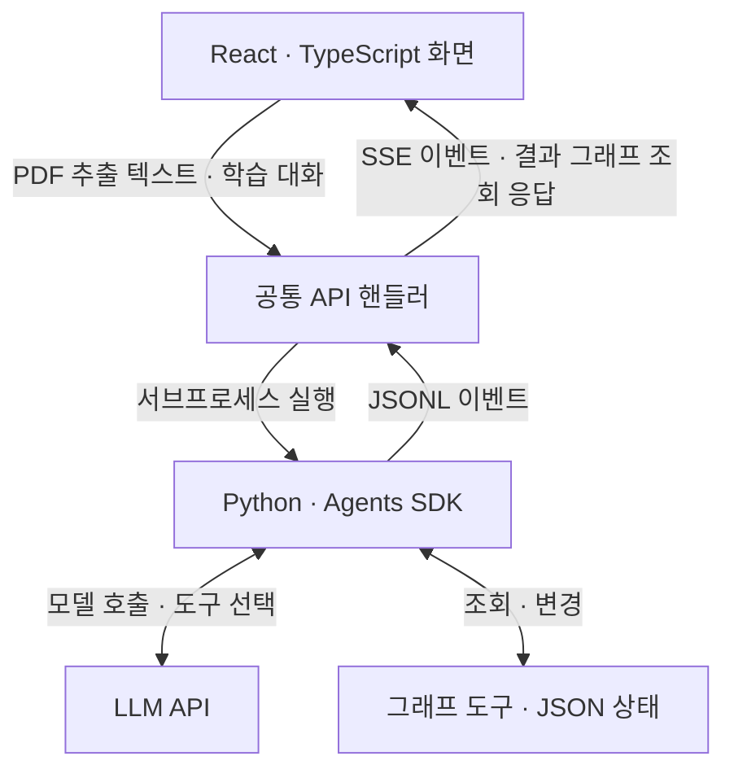

# GRAPHMIND

**강의안과 학습 대화를 개념 지식그래프로 연결하는 AI 학습 도우미.**

강의안 PDF로 개념 지도를 만들고, 공부하며 나눈 대화를 넣어 지도를 확장합니다.
개념을 선택하면 학습 노트와 함께 헷갈렸던 지점, 정정 내용, 근거가 된 대화를 확인할 수 있습니다.

**AGENT:24 해커톤 Creative 트랙 1위 · YAI × OpenAI · 2026.08.01–02 · 4인 팀 · 24시간 개발·배포**

[주요 기능](#주요-기능) · [설계와 구현](#설계와-구현) · [팀 구성과 협업](#팀-구성과-협업) · [실행하기](#실행하기) · [검증](#검증)

## 주요 기능

학습 자료와 대화가 따로 흩어져 있으면 개념 사이의 관계와 자신이 막힌 지점을 다시 찾기 어렵습니다.
GRAPHMIND는 두 입력을 같은 그래프와 노트에 연결합니다.

| 입력·행동 | 동작 | 확인할 수 있는 결과 |
|---|---|---|
| 강의안 PDF 업로드 | 브라우저에서 텍스트를 추출하고 에이전트가 단원·소주제·개념을 구성 | 개념 지식그래프와 노트 |
| 학습 대화 입력 | 기존 개념을 조회하고 필요한 노드·관계·학습 상태를 갱신 | 대화에서 보충한 개념과 연결 관계 |
| 개념 선택 | 해당 개념의 노트와 약점 기록을 표시 | 오개념, 정정 내용, 대화 근거 |
| 에이전트 실행 관찰 | 도구 호출·결과를 스트림으로 전달 | 실행 과정과 그래프 변화 |

API 키 없이도 샘플 데이터로 화면과 대화 반영 흐름을 살펴볼 수 있습니다.
샘플 시연은 고정된 흐름이며, PDF로 그래프를 생성하거나 입력한 대화를 실제로 분석하려면 API 키가 필요합니다.

## 설계와 구현

### 실행 구조



개발 서버와 배포 서버가 같은 API 핸들러를 사용합니다.
실행 중에는 이벤트를 표시하고, 실행이 끝나면 저장된 그래프를 다시 조회해 화면에 반영합니다.
노드 좌표와 레이아웃은 프론트 로컬 상태로 두고 백엔드에는 개념과 관계를 저장합니다.

### 1. 서로 다른 언어로 개발해도 인터페이스가 어긋나지 않게

공통 인터페이스를 **그래프 상태 / 도구 시그니처 / 스트림 이벤트**로 나눴습니다.
Python과 TypeScript에서 같은 구조를 사용하고, `dev`와 `agent` 실행 전에 계약 검사를 거치도록 했습니다.

- 계약 파일 해시, Python·TypeScript 필드 이름, 계약 타입 재선언, 픽스처의 끊어진 간선을 검사합니다.
- 노드 좌표처럼 화면에서만 필요한 값은 공통 계약에 넣지 않았습니다.
- 오프라인 실행과 이벤트 기록으로 API 키가 없는 팀원도 그래프·스트림 UI를 개발할 수 있게 했습니다.

구조·계약 검사는 자동화했지만, 모델이 선택한 개념과 관계의 의미적 정확성까지 보장하는 검사는 아닙니다.
상세 정의: [contract/README.md](contract/README.md)

### 2. 에이전트의 실행 범위를 도구와 호출 상한으로 구분

강의안 실행은 단원과 소주제를 만들 수 있고, 대화 실행은 기존 분류를 사용하면서 개념과 관계를 확장합니다.
대화 에이전트에는 단원·소주제 생성 도구를 제공하지 않아 실행 범위를 제한했습니다.

강의안 처리에서 모델 호출 20턴으로는 일부 개념만 생성하고 멈추는 문제가 있어,
대화는 20턴, 강의안은 기본 80턴으로 상한을 나눴습니다.
이 수치는 **모델 호출 횟수**이며, 한 호출에서 여러 도구를 사용할 수 있습니다.
상한에 도달하면 `limit` 이벤트와 미처리 도구 정보를 남깁니다.

구현: [agent/main.py](agent/main.py), [agent/config.py](agent/config.py)

### 3. 개발 서버에서 동작하던 API를 배포 환경에 연결

정적 빌드에는 Vite 개발 서버의 `/api/agent/*` 미들웨어가 포함되지 않았습니다.
API를 공통 라우트 핸들러로 분리하고, `node:http` 서버가 프론트 빌드와 API를 같은 오리진에서 제공하도록 바꿨습니다.

Python 서브프로세스와 파일 상태 저장을 유지하기 위해 상시 구동 컨테이너를 사용했습니다.
긴 실행 중 프록시가 유휴 연결을 끊는 문제에는 15초 간격 SSE 하트비트를 적용했습니다.

구현: [scripts/agent-api.mjs](scripts/agent-api.mjs), [scripts/serve.mjs](scripts/serve.mjs)

## 팀 구성과 협업

처음 만난 4명이 24시간 동안 개발했습니다. Windows 3명·macOS 1명으로 개발 환경이 달라,
공통 데이터 계약과 동일한 실행 명령을 기준으로 각 영역을 나눠 개발하고 통합했습니다.

| 역할 | 담당 범위 | 관련 경로 |
|---|---|---|
| 에이전트·공통 실행 기반 | Agents SDK 실행, 데이터 계약, 환경 점검, 통합·배포 | [agent/main.py](agent/main.py), [contract/](contract/), [scripts/](scripts/) |
| 그래프 엔진 | 개념 조회·연결·병합, 학습 상태 변경, JSON 상태 저장 | [agent/store.py](agent/store.py), [agent/tools.py](agent/tools.py) |
| 프론트·스트림 | 그래프 렌더링·레이아웃, 실행 스트림, 노트 화면 | [src/](src/) |
| 노트·발표물 | 약점·근거 표현, 시연용 픽스처, 발표 자료 | [contract/fixtures/](contract/fixtures/), [slides/](slides/) |

공통 타입과 실행 기반의 변경을 조율하고, 오프라인 실행·이벤트 기록으로 각 영역을 독립적으로 확인했습니다.
상세한 담당 경계와 협업 규칙은 [AGENTS.md](AGENTS.md)에 남아 있습니다.

## 실행하기

**권장 환경: Node.js 22, Python 3.11, Git.** Windows와 macOS에서 같은 npm 명령을 사용합니다.
설치와 문제 해결은 [개발 안내](docs/development.md)를 참고하세요.

```text
git clone https://github.com/freeman106/graph_agent.git
cd graph_agent
npm install
npm run setup
npm run check
npm run dev
```

`setup`은 Python 가상환경과 의존성, 로컬 `.env`, 저장소의 Git 설정을 준비합니다.
개발 서버가 출력한 주소(기본 `http://localhost:5173`)를 엽니다.

### API 키 없이 살펴보기

`.env`와 실행 환경에 `OPENAI_API_KEY`가 없으면 화면은 샘플 데이터로 동작합니다.
화면의 **샘플 기록 실행**으로 개념 추가와 약점 기록을 확인할 수 있습니다.
이는 실제 모델 추론 결과가 아닌 시연용 흐름입니다.

백엔드의 오프라인 실행은 다음 명령으로 확인합니다. 로컬 그래프 상태와 실행 기록을 생성·갱신합니다.

```text
npm run agent:offline
```

### 실제 모델로 실행하기

`npm run setup`이 만든 `.env`의 `OPENAI_API_KEY`에 본인의 키를 설정하고 개발 서버를 다시 실행합니다.
PDF를 업로드하거나 학습 대화를 입력하면 서버가 실제 모델을 호출합니다.
키는 커밋하지 않으며, 사용할 모델은 [agent/config.py](agent/config.py)의 설정과 계정의 사용 권한을 확인하세요.

배포 형태로 실행하려면:

```text
npm run build
npm run start
```

정적 파일 미리보기인 `npm run preview`에는 에이전트 API가 포함되지 않습니다.
컨테이너·환경변수·영속 볼륨 설정은 [배포 안내](docs/deployment.md)에 있습니다.

## 검증

- `npm run contract:check`: 계약 해시·필드 대조·타입 재선언·픽스처 간선 검사.
- `npm run check`: 환경·패키지 버전, 한국어 인코딩 왕복, Pydantic 픽스처 검증, TypeScript 타입 검사.
- `npm run agent:offline`: 모델 호출 없이 도구 실행과 스트림 형식을 확인하는 고정 시나리오.

## 문서

| 문서 | 내용 |
|---|---|
| [개발 안내](docs/development.md) | 설치, 실행 명령, 상태 파일, Windows 문제 해결 |
| [배포 안내](docs/deployment.md) | 공통 서버, Docker, Railway 배포 기록, 환경변수·운영 제약 |
| [데이터 계약](contract/README.md) | 그래프·도구·스트림 인터페이스 정의 |
| [협업 규칙](AGENTS.md) | 해커톤 당시 역할 분담과 코드 변경 규칙 |
| [해커톤 작업 기록](docs/hackathon-notes.md) | 당시 사용한 역할별 시작 프롬프트 |
| [발표 자료 소스](slides/index.html) | 시연 흐름을 담은 HTML 슬라이드 |
